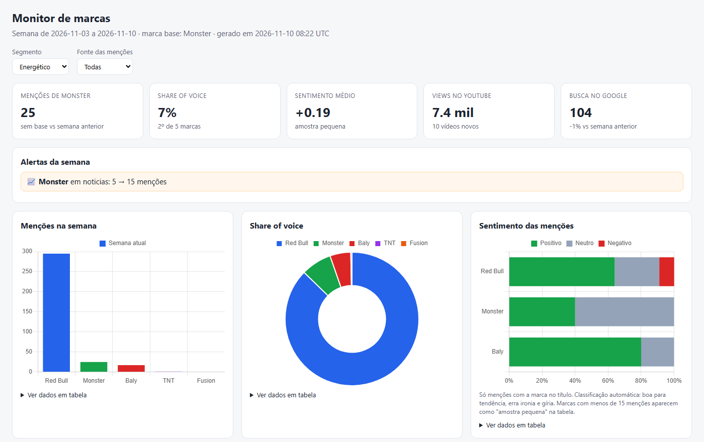

# Monitor de marcas

Acompanha o que se fala de uma marca e dos concorrentes no Brasil: notícias, YouTube e
buscas no Google. Roda uma vez por semana, guarda tudo num SQLite e mostra o resultado
num dashboard comparativo e num relatório em markdown.

O caso de uso aqui é o mercado de bebidas, com o **Monster** como marca base, mas as marcas
ficam todas no `config.json`. Dá pra trocar por qualquer setor sem mexer no código.



## O que ele responde

- Quem está sendo mais mencionado, e quanto isso mudou em relação à semana anterior
- Se apareceu alguma notícia que pode virar crise (risco + sentimento negativo)
- Se um produto está ficando popular no YouTube (views e ganho de views semana a semana)
- O que as pessoas estão buscando sobre a marca no Google (ex.: um sabor novo que disparou)
- Em que tipo de assunto cada marca aparece: produto, marketing, esporte, finanças, risco

## Fontes

| Fonte | Como é coletada | Custo |
|---|---|---|
| Notícias | RSS do Google News, com busca dia a dia quando a marca passa do limite de 100 resultados | grátis |
| YouTube | YouTube Data API v3, filtrando vídeos em português que citam a marca | grátis (cota diária de 10 mil unidades; uma coleta gasta ~4 mil) |
| Google Trends | endpoints internos do site, com a marca base como âncora pra comparar 11 marcas na mesma escala | grátis |
| Sentimento | modelo multilíngue rodando local (ONNX), sem mandar texto pra nenhuma API | grátis |

## Como funciona

```
coletores/  ->  classificar.py  ->  db.py (SQLite)  ->  sentimento.py
                                         |
                                    analise.py
                                    /        \
                          relatorio.py    dashboard.py / servidor.py
```

1. Cada coletor devolve as menções no mesmo formato (fonte, marca, url, título, data, métricas).
2. `classificar.py` marca as categorias por palavra-chave.
3. Tudo vai pro banco. Menção repetida só atualiza as métricas, e as views de cada vídeo
   ficam guardadas por coleta, o que permite medir crescimento.
4. `sentimento.py` classifica o que ainda não tem sentimento.
5. `analise.py` calcula os números da semana. O relatório e o dashboard leem do mesmo lugar,
   então nunca mostram números diferentes.

Alguns cuidados que fazem diferença nos números:

- A busca do YouTube é bem solta. De ~1.400 vídeos que ela devolve, só ~150 ficam: o resto
  não cita a marca de verdade ou não é em português.
- Um alerta de risco só dispara se a menção tem palavra de risco **e** sentimento negativo,
  e não é notícia só de esporte (briga de equipe na F1 não é crise do energético).
- A variação contra a semana anterior só aparece quando a semana anterior foi coletada por
  inteiro. Antes disso aparece "sem base", em vez de um +300% falso.
- A semana é contada a partir da última coleta, não do momento em que você abre o dashboard.

## Instalação

Precisa de Python 3.11 ou mais novo.

```bash
cd monitor_marcas
python -m venv .venv
.venv\Scripts\activate          # Windows (no Linux/Mac: source .venv/bin/activate)
pip install -r requirements.txt
```

### Chave do YouTube

Sem a chave, o coletor do YouTube é pulado e o resto funciona normalmente.

1. Entre em [console.cloud.google.com](https://console.cloud.google.com) e crie um projeto.
2. Em **APIs e serviços > Biblioteca**, ative a **YouTube Data API v3**.
3. Em **Credenciais > Criar credenciais > Chave de API**, gere a chave.
4. Restrinja a chave só pra YouTube Data API v3.
5. Copie `.env.example` para `.env` e cole a chave em `YOUTUBE_API_KEY=`.

## Uso

```bash
python coletar.py --dias 14     # primeira vez: já pega a semana anterior pra comparar
python coletar.py               # depois disso, uma vez por semana
python coletar.py --so-relatorio  # regera relatório e dashboard sem coletar (ex.: depois de editar o config)
```

Na primeira execução o modelo de sentimento (~136 MB) é baixado para `modelos/`.

Cada coleta gera:

- `relatorios/AAAA-MM-DD.md`: relatório da semana
- `dashboard.html`: dashboard estático, abre direto no navegador (bom pra mandar pra alguém)

### Dashboard ao vivo

```bash
python servidor.py
```

Abra [http://127.0.0.1:8050](http://127.0.0.1:8050). A página lê o banco direto, se atualiza
sozinha a cada minuto e tem um seletor pra ver coletas anteriores. O servidor só aceita
conexões do próprio computador e abre o banco em modo somente leitura.

## Configuração

Tudo fica no `config.json`:

```jsonc
"marcas": {
  "Monster": {
    "grupo": "Monster Beverage (distrib. Coca-Cola)",
    "segmento": "Energético",
    "buscas": ["\"Monster Energy\"", "\"energético Monster\""],  // o que é pesquisado
    "termos": ["monster energy", "monster ultra"],                // o que conta como menção
    "trends": "/m/061dl5"                                         // tópico do Google Trends (ou palavra-chave)
  }
}
```

- `marca_base`: a marca de referência (destaque no dashboard e âncora do Trends)
- `categorias`: palavras-chave de cada categoria (risco, produto, marketing...)
- `alerta`: a partir de quanto aumento um pico vira alerta
- `youtube.cota_max_por_coleta`: teto de cota gasto por coleta

Mudou o config? Rode `python coletar.py --so-relatorio` e as categorias são reaplicadas em
todo o histórico.

## Estrutura

```
monitor_marcas/
├── coletar.py          # ponto de entrada da coleta semanal
├── servidor.py         # dashboard ao vivo (FastAPI)
├── config.json         # marcas, categorias e alertas
├── analise.py          # números da semana
├── relatorio.py        # relatório em markdown
├── dashboard.py        # página do dashboard (Chart.js)
├── classificar.py      # categorias por palavra-chave
├── sentimento.py       # modelo de sentimento local
├── db.py               # schema e gravação no SQLite
└── coletores/
    ├── noticias.py     # Google News RSS
    ├── youtube.py      # YouTube Data API
    ├── trends.py       # Google Trends
    └── util.py         # cliente HTTP com retry, leitura do .env, busca de termos
```

## Limitações

- **Sentimento:** é um modelo pequeno. Serve pra tendência, mas erra ironia e humor. Vídeo
  de "briga Coca vs Pepsi" sai como negativo. Marcas com menos de 15 menções aparecem como
  "amostra pequena".
- **Categorias:** por palavra-chave, então escapa coisa. "Agência critica conta da Coca-Cola"
  cai em risco sem ser risco do produto. Ajusta-se no `config.json`.
- **Notícias:** só o título é analisado; o texto da matéria não é baixado.
- **Google Trends:** usa endpoints não oficiais. Se o Google mudar algo, só essa fonte para.
- **Marcas pequenas:** TNT e Fusion quase não aparecem. Isso em si já é informação, mas os
  números delas oscilam muito.

## Próximos passos

- TikTok e Instagram (via serviço pago por resultado, com teto de gasto)
- Agendamento automático da coleta semanal

## Sobre os dados

O projeto usa só fontes públicas ou oficiais (RSS, API do YouTube, Trends) e guarda menções
pra análise agregada da marca. Não monta histórico de pessoas nem coleta nada que exija login.
